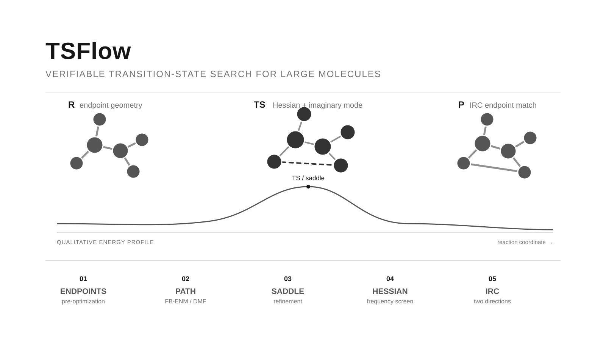

# TSFlow

> **TSFlow: Verifiable Transition-State Search for Large Molecules**
>
> 面向大分子反应的可验证过渡态搜索后端与算法库。

**English:** [README.en.md](README.en.md) · **License:** [MIT](LICENSE)



*流程示意：端点准备 → 过渡态筛选 → 双向 IRC 验证；图中分子与能量曲线均为示意。*

TSFlow（Transition-State Flow）把大分子过渡态搜索组织成一条可追踪、可替换、可验证的计算流程。当前以 UMA 作为主力引擎，同时为 xTB、Gaussian 和其他计算 provider 保留统一接入位置。

这个项目把过渡态搜索拆成一条可替换、可追踪、可验证的计算流水线：从反应位点定义和端点预优化开始，生成路径初猜，精修一阶鞍点，进行全体系 Hessian 筛选，最后用双向 IRC 检查过渡态是否真的连接预期的反应物和产物。

它面向的是传统量子化学工作流最容易变慢的场景：原子数较多、反应坐标复杂、需要反复筛选初猜的大分子体系。项目以 UMA 作为高频搜索和优化的主力引擎，同时保留 xTB、Gaussian 等计算 provider 的替换位置，让快速搜索、精细复核和后续模型升级可以分阶段完成。

## 项目亮点

### 为大分子过渡态搜索而设计

- 将端点、路径、鞍点、频率和 IRC 分成独立阶段，每个阶段都能保存中间结果并单独重跑。
- 采用机器学习势承担大体系中的大量能量、力和 Hessian 评估，减少对高成本量子化学计算的依赖。
- 通过反应坐标、成键/断键关系、配位关系和端点拓扑匹配，把“几何上看起来像 TS”与“确实连接目标反应”区分开。

### 不把路径搜索限定在单一算法上

当前算法库提供 FB-ENM 路径初猜和 Direct MaxFlux 路径优化，并通过统一的 `PathInitializer`、`PathOptimizer` 和 `TransitionStateValidator` 契约连接起来。后续可以在不改动后端任务接口的情况下接入 IDPP、导入路径或其他路径搜索方法。

### 从候选结构走到验证结论

工作流不仅输出一张结构图片或一条能量曲线，还会分别记录：

- 端点是否完成预优化；
- 鞍点是否达到力收敛；
- 全体系 Hessian 是否显示单一显著虚频；
- 虚频方向是否与定义的反应坐标一致；
- 双向 IRC 是否沿相反方向展开；
- IRC 两端的重原子拓扑是否匹配预期反应物和产物。

这使计算状态、结构候选和科学验证结论可以被单独审查，不会把“任务执行完成”误当成“机理已经证明”。

### API-first，方便接入自动化平台

算法库不依赖 FastAPI、数据库或项目私有路径；后端通过模块化路由、任务 Worker 和 provider 注册表提供 HTTP 接口。未来可以在其上增加 AI 反应定义层，让调用方提交分子、反应位点和计算偏好，由规划层生成明确的计算任务。

## 工作流总览

```text
反应物 / 产物 / 反应位点
            |
            v
       端点预优化
            |
            v
  FB-ENM / Direct MaxFlux 路径初猜
            |
            v
        鞍点精修
            |
            v
   全体系 Hessian 与虚频筛选
            |
            v
       双向 IRC 跟踪
            |
            v
      端点拓扑与反应坐标验证
```

对于已经有 TS 初猜的体系，可以跳过路径生成，直接进入鞍点精修、Hessian 和 IRC 阶段：

```text
R / TS guess / P  ->  UMA 鞍点精修  ->  Hessian 筛选  ->  双向 IRC
```

## 为什么选择 UMA

项目的目标不是用一个模型替代所有量子化学方法，而是把最耗时的“大体系搜索”变成可迭代的快速计算阶段。作为选型背景，[公开 GMTKN55 Barrier Heights 分类结果](https://benchmarks.rowansci.com/benchmarks/gmtkn55)报告了 UMA Small 1.1 和 UMA Medium 1.1 约 3 kcal/mol 的反应能垒误差。这个公开结果支持我们优先评估 UMA，但不代表本项目已经完成与其他方法的统一复现或横向基准测试，也不代表 UMA 对所有大分子反应或所有 TS 自动搜索都能成功。

实际工作流仍然要求对候选结构进行 Hessian、虚频和 IRC 验证；需要更高等级的独立复核时，可以在后续阶段接入 Gaussian 或其他量子化学程序。电子能垒也应与包含溶剂、温度和熵效应的实验活化自由能分开报告。

## 与常见方案的定位对比

下面的比较是工作流能力和产品定位的对比，不是统一分子、统一硬件和统一收敛标准下的速度或成功率 benchmark。我们的重点是把“大分子过渡态搜索”和“结果验证”组织成一个可替换的后端流程。

| 方案 | 主要优势 | 常见限制 | 本项目的差异化 |
| --- | --- | --- | --- |
| Gaussian / ORCA 等量子化学程序 | 电子结构描述成熟，适合高等级能量与最终复核 | 大体系单次计算和 Hessian 成本高；路径初猜、任务编排和结果管理通常需要用户自行组织 | 用 UMA 承担高频搜索，再把 Gaussian 等程序放在可替换的复核层；统一保存路径、鞍点、Hessian 和 IRC 状态 |
| GFN-xTB 等快速半经验方法 | 结构预优化和粗筛速度快，部署门槛低 | 反应能垒和复杂过渡态的可靠性需要针对体系验证；通常不提供完整 TS 搜索产品闭环 | 可作为 xTB provider 接入端点预优化和低成本筛选，同时用 UMA 完成主搜索和验证 |
| ASE NEB / 独立路径脚本 | 路径优化接口成熟，适合已有端点和明确路径的研究计算 | 需要用户准备初始路径；NEB 本身不等于一阶鞍点确认，也不负责完整 IRC 和端点拓扑判定 | 提供 FB-ENM 与 Direct MaxFlux 路径阶段，并把鞍点精修、虚频筛选和双向 IRC 接到同一工作流 |
| AutoTS / 专用 TS 自动搜索工具 | 面向特定反应类型提供较高层自动化 | 适用反应范围、计算引擎和输入格式往往较固定；大分子和自定义配位语义需要额外适配 | 以反应坐标、成键/断键、金属配位和原子映射为显式输入，后端契约和 provider 可替换 |
| 本项目 | 面向大分子、UMA 主力、算法库与 API 解耦、验证链完整 | 仍是研究开发版本；通用自动搜索成功率和跨方法性能尚未建立公开 benchmark | 将快速搜索、候选筛选、科学验证和任务持久化放进一条可审查流水线，并为 AI 任务规划预留接口 |

### 我们的核心优势

1. **计算分层**：用 UMA 处理大体系中最频繁的能量、力和 Hessian 评估，把高成本量子化学计算留给需要复核的阶段。
2. **算法可替换**：路径初猜、路径优化、鞍点精修、Hessian 和 IRC 都有独立边界，NEB、IDPP 或其他 provider 可以逐步接入。
3. **验证可追溯**：从“找到候选结构”一直记录到“是否为一阶鞍点”和“IRC 是否连接预期端点”，结果不是只给一张 TS 图片。
4. **服务化集成**：算法库不绑定 FastAPI，后端提供任务、取消、持久化和结果附件接口，便于接入实验数据平台或后续 AI 规划层。

速度、成功率和能垒误差的横向结论，需要后续使用公开小分子基准和代表性大分子体系，按统一硬件、模型、收敛标准和参考方法单独测量。

## 计算引擎分层

| 层级 | 当前定位 | 适合的任务 |
| --- | --- | --- |
| UMA | 主力引擎 | 大体系能量、力、优化、路径筛选、Hessian 和 IRC |
| xTB | 快速辅助 provider | 端点预优化、初步结构筛选和低成本对照 |
| Gaussian | 可替换的外部计算适配层 | 已有初猜的高等级复核和用户自定义计算 |
| ORCA | 研究阶段外部复核 | 当前尚未接入通用后端 provider |

provider 只负责提供 ASE calculator；路径搜索、鞍点筛选和 IRC 验证由独立算法包完成。因此新增计算引擎不会迫使调用方重写整套工作流。

## 目录结构

```text
packages/uma-workflows/     与 HTTP 无关的路径、鞍点、频率和 IRC 算法库
backend/                    FastAPI 路由、任务 Worker、存储和计算引擎适配
backend/app/contracts/      稳定的数据契约
backend/app/adapters/       UMA、xTB、Gaussian 等 provider 适配
backend/app/calculators/    模型注册与能力选择
backend/app/formats/        XYZ、SDF、Gaussian 输入输出
docs/                       公共架构、工作流和安装文档
examples/                   不依赖研究分子的通用示例
scripts/                    安装、启动、检查和源码导出工具
calculations/               本地研究计算记录，不属于首个 GitHub 源码包
frontend/                   本地 Web 工作台，当前不随首个源码包发布
```

## 快速开始

需要 Python 3.11+ 和 `uv`。完整环境、模型授权和可选依赖请看 [安装与启动](docs/quickstart.md)。

```bash
uv venv --python 3.13 .venv-uma
scripts/install-backend-env.sh
cp backend/.env.example backend/.env
scripts/run-backend.sh
```

服务默认监听 `http://127.0.0.1:8010`，OpenAPI 文档位于 `/docs`。模型权重需要按照上游授权单独获取，不随仓库分发。

算法库的发行包名为 **`tsflow-chem`**，可从 GitHub 独立安装：

```bash
pip install "tsflow-chem @ git+https://github.com/wxyhgk/TSFlow.git#subdirectory=packages/uma-workflows"
pip install "tsflow-chem[all] @ git+https://github.com/wxyhgk/TSFlow.git#subdirectory=packages/uma-workflows"
```

发布到 PyPI 后即可使用 `pip install tsflow-chem` 或 `pip install "tsflow-chem[all]"`。目前尚未发布到 PyPI。Python 导入名保持 `uma_workflows`；`pip install tsflow` 和 `pip install ts-flow` 安装的都是其他项目。

独立 Python API、TS 输入约定和结果判定见 [过渡态工作流](docs/transition-state-workflow.md)；路由和 provider 的替换位置见 [架构与扩展](docs/architecture.md)。

## 当前可用范围

- 算法库已提供 FB-ENM、Direct MaxFlux、鞍点精修、Hessian 分析、虚频筛选和双向 IRC 组件。
- 后端已提供已有 TS 初猜的精修、Hessian、IRC、任务持久化和结果附件接口。
- UMA、xTB、Gaussian 的 provider 位置已经分层；具体任务能力和本机安装状态以 `GET /api/v1/models` 为准。
- 通用的“只输入分子和反应位点、自动规划并完成全部 TS 搜索”的 HTTP 入口仍在产品化中。
- 本仓库当前是研究开发版本；通用反应成功率、跨环境耗时和完整前端发布流程仍需要独立基准与干净环境验证。

## 路线图

1. 发布不依赖本地研究文件的小反应完整示例和可复现实验记录。
2. 完善无初猜 HTTP 自动搜索入口，统一输入映射、反应坐标和结果状态。
3. 增加 AI 反应定义与任务规划层，将自然语言目标转换为可审查的计算计划。
4. 补齐项目许可证、第三方来源清单和可重复安装的发布包。

## 文档入口

- [安装与启动](docs/quickstart.md)
- [过渡态工作流](docs/transition-state-workflow.md)
- [架构与扩展](docs/architecture.md)
- [计算引擎说明](docs/calculator-providers/README.md)
- [GitHub 发布准备](docs/github-release.md)
- [当前项目状态](PROJECT_STATUS.md)
- [算法库说明](packages/uma-workflows/README.md)

## 许可证与模型权重

项目源码采用 [MIT License](LICENSE)。`model-assets/UMA/LICENSE` 仅适用于上游 UMA 模型；UMA 权重、研究结构、计算结果、机器信息和本地算力记录不随公开源码包分发。
